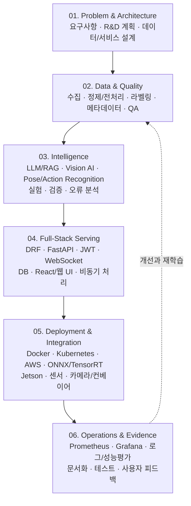

<!-- GitHub Profile README | handgonpo/handgonpo -->

# AI Full-Stack · Vision AI · R&D / PBL

### From AI-Native Services to Real-World Systems

**데이터 설계와 전처리부터 AI 추론, 풀스택 서비스, 산업현장 연동, 연구개발과 실무교육까지 연결합니다.**

AI Backend / DRF / FastAPI · LLM/RAG · Vision AI / Action Recognition · Edge AI / XR · Cloud / DevOps

[**성과**](#-impact-at-a-glance) · [**대표 프로젝트**](#-selected-rd--engineering-projects) · [**핵심 역량**](#-what-i-do) · [**기술 스택**](#-tech-stack) · [**R&D·교육 경력**](#-experience--pbl-education)

---

## 👋 About Me

**저는 AI 모델을 '시연'에서 끝내지 않고, 데이터·백엔드·프론트엔드·인프라를 연결해 검증 가능한 시스템으로 만드는 AI 융합 개발·연구·교육 전문가입니다.**

- **AI-Native Full-Stack:** 요구사항 정의 → 데이터/DB 설계 → 전처리 → LLM/RAG·Vision AI → **DRF/FastAPI** → 실시간 Web/API → Cloud·Edge 배포 → 운영 모니터링
- **Industrial AI & R&D:** 산업안전 관제, 지오펜싱, 센서 데이터 분석, 객체검출·자세추정·동작인식, XR·Simulation 프로젝트의 **PM/PL 및 기술개발**
- **PBL Education:** 기술 설명을 넘어 **동작하는 결과물, 테스트, 코드 리뷰, GitHub, 성능보고서, 면접 발표**까지 이어지는 산출물 중심 교육

## 📊 Impact at a Glance

| **16년+** | **6건 · 납품 100%** | **A등급 3건** | **AI Hub 공개 2건** |
| :---: | :---: | :---: | :---: |
| IT·AI·XR 실무 교육·멘토링 | 참여·총괄 국책 R&D 과제 | 정부 평가 성과 | 데이터·프로젝트 산출물 |

> **성과 기준:** 경력기술서에 기재된 수행·평가·공개 실적입니다. 특히 R&D 관련 수치는 **2023–2025년 수행 프로젝트** 기준이며, 모든 경력 기간의 합계는 아닙니다.

---

## 🚀 Selected R&D & Engineering Projects

### 01. 산업안전 실시간 관제 플랫폼 · AI / Full-Stack

**문제:** 여러 종류의 유해가스·센서 정보를 지연 없이 수집하고, 위험 징후를 분석해 현장 담당자에게 전달해야 합니다.

- **수행 내용:** **9종 유해가스 센서 데이터**의 수집·저장, AI 이상탐지·위험도 추론, 이벤트·알림, 실시간 대시보드 연결
- **아키텍처:** 센서 데이터 → 비동기 처리 → DB 저장 → AI 분석 → WebSocket 실시간 알림·화면
- **기술:** **DRF · FastAPI · PostgreSQL · Redis · Celery · WebSocket**
- **기여:** DRF/FastAPI 기반 실시간 분석 파이프라인 구현 및 기술지도

### 02. 지오펜싱 기반 산업재해 예방 관제 · R&D PL

**문제:** 위험구역 진입과 위치 기반 이벤트를 빠르게 감지하고 관제·알림 체계에 반영해야 합니다.

- **기간 / 역할:** **2026.06–현재 · 기술부설연구소 소장(비상근), 프로젝트 PL**
- **주요 수행:** 현장 요구사항 분석, 위험구역·지오펜싱 설계, 실시간 진입 감지 및 경고·관제 연계 구조 설계, 개발 일정·기술 구현 관리
- **현재 상태:** **진행 중인 R&D 과제** — 완료·상용 운영 성과로 표기하지 않음

### 03. 로봇 명령어 데이터셋·합성 데이터 시뮬레이션 · NIA R&D PL

**문제:** 실제 촬영만으로 확보하기 어려운 로봇 학습용 데이터를 체계적으로 구축해야 합니다.

- **역할:** **데이터 구축 프로젝트 PL**
- **주요 수행:** Unity Perception 기반 **RGB-D · Semantic Segmentation** 데이터 생성, 학습용 데이터 구조 및 시뮬레이션 관리
- **성과:** 수행 경력에 **AI Hub 공개 산출물 2건** 기재(여러 프로젝트에 걸친 공개 실적)
- **기술:** Unity · Synthetic Data · Image/Annotation Pipeline · 데이터 품질관리

### 04. 실시간 동작추정·XR 시뮬레이션 · Project PM

**문제:** 사람의 자세·동작을 인식하고, 3D 공간에서 비교·시각화하는 서비스가 필요합니다.

- **수행 내용:** Unreal 기반 **Pose Estimation 연동**, 관절 정보·동작 비교, 실시간 시각화 및 사용자 경험 설계
- **연관 실습:** YOLO/MediaPipe Keypoint → Sequence Feature → Action Recognition → FastAPI/WebSocket → Three.js·Unreal 시각화
- **기술:** Python · OpenCV · YOLO · Unreal Engine · Unity · Three.js

### 05. AI Backend · LLM/RAG · 교육용 서비스 구현

**문제:** 모델 실험 결과를 실제 이용 가능한 API·웹 서비스와 재현 가능한 개발 환경으로 연결해야 합니다.

- **수행 내용:** **DRF/FastAPI API**, JWT 인증, DB 모델링, 비동기 작업, OpenAI API·RAG 활용, Docker/AWS 배포 및 CI/CD 실습
- **데이터 중심 설계:** 소스 수집 → 정제·분할 → 메타데이터/스키마 → 임베딩·검색 → 근거 기반 응답 → 로그·평가
- **기술:** DRF · FastAPI · PostgreSQL/MySQL · Redis · Docker · GitHub Actions · AWS
- **형태:** 프로젝트 기반 실습과 PoC, AI 백엔드 교육에서 검증·개선한 서비스 구현 사례

**공개 가능한 코드와 재현용 자료:** [GitHub Repositories](https://github.com/handgonpo?tab=repositories) · [Vision AI 실습 저장소](https://github.com/handgonpo/Vision_AI_Class) · [AI Restaurant Backend](https://github.com/handgonpo/AIRestaurant)

> **프로젝트 공개 범위:** 기업·국책 R&D 원본 코드 및 데이터는 보안·저작권 정책을 준수합니다. 공개 가능한 아키텍처·실습 코드·기술문서를 중심으로 소개합니다.

---

## 🎯 What I Do

| 역량 | 구체적 수행 범위 |
| :--- | :--- |
| **AI-Native Service / LLM-RAG** | Prompt·문서 수집, 전처리·청킹, 임베딩·검색, 응답 생성, AI API 및 평가 흐름 설계 |
| **Backend / Full-Stack** | **DRF·FastAPI**, 인증/JWT, 데이터 모델링, 비동기 작업, WebSocket, React·웹 대시보드 연동 |
| **Data Engineering** | 수집·정제·라벨링·스키마/메타데이터 설계, Train/Val/Test 분할, QA 및 재현성 관리 |
| **Vision AI / Action Recognition** | OpenCV, YOLO, Pose/Keypoint, Skeleton, 객체검출·동작 분류, 성능 평가 및 오류 분석 |
| **Industrial / Edge AI** | 센서·산업용 카메라·컨베이어 연동 설계, ONNX·TensorRT 추론 최적화, Jetson·Raspberry Pi 활용 |
| **Cloud / DevOps / MLOps** | Docker·Kubernetes, AWS EC2/S3/G5, GitHub Actions, Nginx, Prometheus·Grafana 관측·운영 |
| **XR / Simulation** | Unity/C#, Unreal Engine, VICON/FBX, 3D 동작 시각화 및 합성 데이터 생성 |
| **R&D PM/PL & PBL** | 과제 기획, 일정·리스크·요구사항, PoC, 기술문서, 코드 리뷰, 팀 프로젝트 및 취업 포트폴리오 지도 |

## 🔄 End-to-End AI Development

> 각 프로젝트의 데이터·장비 조건에 따라 모델 개발, API 개발, 현장 연동은 반복적으로 검증합니다. 다이어그램은 **대표 개발 프로세스**이며 모든 프로젝트에 동일한 기술이 쓰였다는 의미는 아닙니다.

---

## 🛠 Tech Stack

**Primary:**

<b>전체 기술 스택 펼치기 · AI Full-Stack / Data / Edge / XR</b>

| 분야 | 기술 |
| :--- | :--- |
| **Backend / API** | Python, **DRF**, Django, FastAPI, Flask, Java, Spring, JWT, Django Channels, WebSocket, Celery |
| **Frontend / Web** | HTML5, CSS3, JavaScript, React, Vite, Three.js, React Native, jQuery |
| **Database / Cache** | PostgreSQL, MySQL, Redis |
| **AI-Native / LLM-RAG** | OpenAI API, Prompt Engineering, Embedding, RAG Pipeline, Hugging Face, Transformers, LangChain/LlamaIndex 관련 설계·실습 |
| **Data / ML** | Pandas, NumPy, Scikit-learn, TensorFlow, PyTorch, 데이터 전처리·라벨링·시각화, Matplotlib/Seaborn |
| **Vision / Motion** | OpenCV, YOLO, MediaPipe, Pose Estimation, Object Detection, Action Recognition, Keypoint, Synthetic Data |
| **Cloud / DevOps / MLOps** | Linux/Ubuntu, Docker, Docker Compose, Kubernetes, AWS EC2·S3·G5, Nginx, GitHub Actions, Prometheus, Grafana |
| **Edge / Deployment** | ONNX, TensorRT, NVIDIA Jetson, Raspberry Pi, 센서·카메라 인터페이스 |
| **XR / Simulation** | Unity, C#, Unreal Engine, Blender, 3ds Max, VICON, FBX, XR Interaction Toolkit, AR Foundation |
| **Collaboration / Documentation** | Git, GitHub, VS Code, Insomnia, Notion, Obsidian, Figma, API 문서, 테스트 리포트 |

**기술 범위:** 실무 프로젝트 적용, PoC 수행, 실습 설계·지도 경험을 포함합니다. 기술별 적용 수준과 구현 내용은 프로젝트 사례에서 구분해 설명합니다.

---

## 🧭 Experience & PBL Education

| 기간 | 조직 / 역할 | 핵심 업무 |
| :--- | :--- | :--- |
| **2026.10–현재** | Vision AI·산업 Vertical AI 전문과정 · **주강사** | 제조·산업안전 분야 실습, 컴퓨터 비전·Edge AI·프로젝트 지도 |
| **2026.06–현재** | ㈜디코나이 · **기술부설연구소 소장(비상근) / PL** | 지오펜싱 기반 산업안전 관제 R&D, 기술 아키텍처·개발 관리 |
| **2025.11–2026.07** | ㈜멋쟁이사자처럼 · **주강사** | Python·DRF·FastAPI·LLM/RAG, AI 서비스 MVP 및 포트폴리오 지도 |
| **2024.03–2025.06** | 국민대학교 · **캡스톤 멘토** | PoC·논문·시제품 제작, 코드 리뷰·발표·연구 멘토링 |
| **2023.01–2025.01** | ㈜미디어그룹 사람과숲 · **부장 / PM·PL / 연구원** | AI·VR·XR·로봇 데이터·R&D 과제 총괄 및 납품 |
| **2019.08–2022.07** | KM Academy & SSM · **Program Director** | 해외 교육기관 운영, IT·AI·Unity 교육과정·산학 프로젝트 기획 |

### PBL: 학습에서 면접까지 이어지는 교육 설계

**수업의 종료 기준을 ‘코드 작성’이 아니라 ‘검증 가능한 결과물’에 둡니다.**

| 단계 | 학생이 설명·제출할 산출물 |
| :--- | :--- |
| **문제 정의** | 문제 배경, 사용자/업무 요구사항, 성공 기준(KPI) |
| **설계** | 시스템 아키텍처, ERD·데이터 스키마, API 명세, 일정·역할 |
| **구현** | 실행 가능한 소스코드, Git 이력, 환경 설정, AI 모델·API 연동 |
| **검증** | 데이터 분할·평가 기준, API 테스트, 실패 사례, 성능·재현성 리포트 |
| **발표·취업** | 시연 영상, README, 기술문서, 개인 기여도, 기술 선택 근거와 개선 계획 |

- **교육 운영 사례:** AI 활용 Python 프로덕트 개발 과정 **1기 25명**, 팀 프로젝트 기반 실습(제공 포트폴리오 기재)
- **산학 멘토링:** 국민대학교 캡스톤 지도, 학생 프로젝트의 **대회 1위 및 CES 전시 참여** 관련 멘토링 경험(수상 주체는 학생·팀)
- **국제 교육:** 해외 IT·AI·Unity 교육과정 및 교육기관 운영 경험

### Research & Education

- **연구 주제:** 위치기반 조건 반응 애플리케이션, AR 기반 서비스, 가상 착용 기술, 오픈소스 sLLM 연구
- **학력:** 박사
- **박사논문:** *Development of sLLMs using the Open-Source Sakura-SOLAR-Instruct Model*
- **직업훈련교사 자격 분야:** 인공지능, 정보기술개발, 문화콘텐츠, 멀티미디어 등

---

## 📬 Contact & Collaboration

**AI-Native 서비스 · 산업용 Vision/Edge AI · R&D 프로젝트 · 산학협력 · PBL 교육** 관련 협업을 환영합니다.

- **GitHub:** [github.com/handgonpo](https://github.com/handgonpo)
- **Email:** [handgonpo@naver.com](mailto:handgonpo@naver.com)
- **Project Code & Practice:** [Repositories](https://github.com/handgonpo?tab=repositories)

Define the problem · Design the data · Build the system · Evaluate the results · Share the evidence

