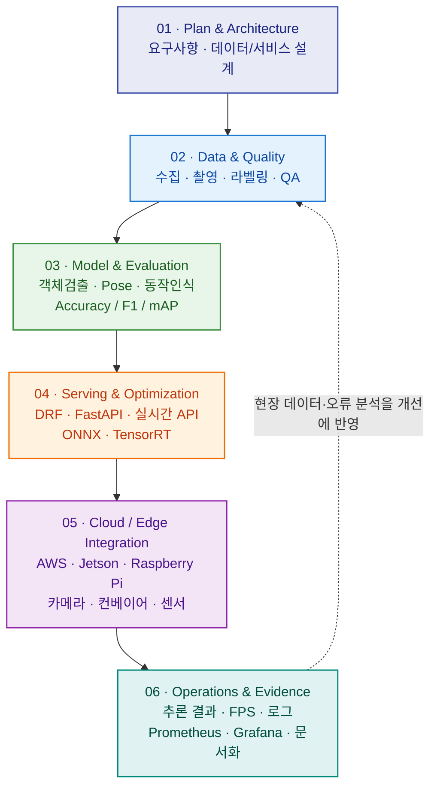

<!-- GitHub Profile README | github.com/handgonpo/handgonpo -->

# AI Backend · Vision AI · Edge AI

### From AI Research to Real-World Systems & Education

**AI 백엔드와 컴퓨터 비전, 산업용 Edge AI를 하나의 서비스로 연결하는 개발·연구·교육 전문가**

Python · Django REST Framework · FastAPI · PyTorch · OpenCV · YOLO · Docker · AWS

[**Projects**](#-selected-projects) · [**Expertise**](#-core-expertise) · [**Tech Stack**](#-tech-stack) · [**Education**](#-research--education)

---

## 👋 About Me

**제가 만드는 것은 개별 AI 모델이 아니라, 현장에서 동작하고 검증할 수 있는 End-to-End AI 시스템입니다.**

Python 기반 API 서비스, 객체검출·자세추정·동작인식, LLM/RAG, Unity·Unreal Engine 시뮬레이션을 연결합니다. 데이터 설계와 모델 평가에서 끝내지 않고 **실시간 추론 → API·디바이스 연동 → Cloud·Edge 배포 → 모니터링·기술문서화**까지 일관된 흐름으로 설계하는 데 강점이 있습니다.

AI·Big Data 석사 학위와 DBA 과정의 연구 경험을 바탕으로, 개발·R&D PM/PL·프로젝트 기반 교육(PBL)을 함께 수행해 왔습니다.

| 경험 및 작업 범위 | 확인 가능한 규모 | 의미 |
| :--- | :---: | :--- |
| 개발·교육·멘토링 | **16년+** | 실무형 커리큘럼 설계 및 프로젝트 지도 경험 |
| Vision AI 교육과정 구성 | **교과 7–15 / 9개 교과** | 라벨링 → 객체검출 → 머신비전·Pose → Edge → 최종 프로젝트 연계 |
| 동작인식 교육용 데이터 구성 | **3명 · 6개 동작 · 18개 클립** | Subject-wise Train / Validation / Test 분리 실습 |

> 위 수치는 **경력 및 교육용 프로젝트의 범위**입니다. 모델 성능, 운영 비용 절감, 서비스 사용자 수 등의 실측 성과를 뜻하지 않습니다.

## 🚀 Selected Projects

**관심 기술보다 실제 문제·구현 과정·재현 가능한 결과를 먼저 보여줍니다.**

| Project | Problem & Contribution | Stack / Evidence |
| :--- | :--- | :--- |
| [**Pose & Action Recognition**](https://github.com/handgonpo/subject10_pose_action) | 웹캠·동영상에서 Keypoint를 추출하고, 시간 흐름에 따른 동작 분류·데이터 보강·성능 비교를 실습 가능한 파이프라인으로 구성 | Python, YOLO Pose, OpenCV, scikit-learn / **6 Actions · 3 Subjects · 18 Clips** |
| [**Vision AI Learning & Projects**](https://github.com/handgonpo/Vision_AI_Class) | 머신비전, 자세추정, 합성데이터, VICON, Edge AI, 제조·산업안전 프로젝트를 연결한 실습형 교육 자료 | OpenCV, PyTorch, YOLO, FastAPI, Raspberry Pi, Jetson / **교과 7–15** |
| [**AI Restaurant Backend**](https://github.com/handgonpo/AIRestaurant) | 외부 장소 데이터 수집·관리와 AI 추천 서비스의 백엔드·API 및 배포 구조를 개발·실습 | Django, DRF, FastAPI, MySQL, Docker, AWS EC2, GitHub Actions |
| [**DICONAI Data Platform**](https://github.com/handgonpo/diconai-projects) | 센서 데이터 수집부터 저장·분석·알림·모니터링까지 이어지는 데이터 서비스 구조를 다루는 프로젝트 | DRF, FastAPI, PostgreSQL, Redis, Celery, Docker Compose, Prometheus, Grafana |

> 각 저장소는 서로 다른 **프로젝트·실습 단계**를 보여줍니다. 상용 서비스 운영 성과와 교육용 PoC를 동일하게 표현하지 않았습니다.

## 🎯 Core Expertise

| Focus | What I Build / Design |
| :--- | :--- |
| **AI Backend · LLM/RAG** | Django REST Framework·FastAPI 기반 REST API, 인증, AI 모델 서빙, 검색·질의응답 연동 |
| **Computer Vision · Action Recognition** | OpenCV·YOLO·MediaPipe 기반 객체검출, Pose/Keypoint, Skeleton, 시계열 동작 분류 |
| **Industrial Vision · Edge AI** | 산업용 카메라·조명·컨베이어 연동 구조, 검사 결과 시각화, ONNX·TensorRT, Jetson·Raspberry Pi |
| **Cloud · DevOps · Observability** | AWS EC2·S3·G5, Docker·Kubernetes, GitHub Actions CI/CD, Prometheus·Grafana 모니터링 |
| **XR · Simulation · Motion Capture** | Unity·C#, Unreal Engine, Blender, VICON 모션 데이터 및 3D 시각화 |
| **R&D · PBL Education** | 요구사항·아키텍처·데이터셋·성능평가·기술문서를 연결하는 프로젝트 기획과 실습 교육 |

## 🔄 End-to-End AI Development

## 🛠 Tech Stack

**Core:** Python · Django/DRF · FastAPI · PyTorch · OpenCV · YOLO · Docker · AWS · ONNX/TensorRT

<b>전체 기술 스택 보기 · 8개 분야</b>

### Backend / API

### Frontend / Web

### Database

### DevOps / Cloud / Monitoring

### AI / Data / Vision

### AI Deployment / Edge AI

### XR / Simulation / Motion Capture

### Collaboration / Development Tools

## 🎓 Research & Education

**문제 정의 → 구현 → 검증 → 문서화까지 학생이 스스로 완성하도록 설계하는 실습형 교육**을 지향합니다.

- **2026.10–현재** · 현장 데이터 기반 Vision AI & 산업분야 Vertical AI 과정 교육
- **2025.11–2026.07** · AI 활용 Python 프로덕트 개발 과정 주강사
- **2024.03–2025.06** · 국민대학교 캡스톤 연구수업 멘토링
- **2019.08–2022.07** · IT 교육과정 운영 및 Program Director

### Quantified Project Criteria (교육과정 설계 목표 · 실측 성과 아님)

| 교육 프로젝트 | 설계·평가 기준 |
| :--- | :--- |
| **제조 Vision AI** | 최소 **5개 검출 클래스**, 이미지 **500장 이상**, 목표 **mAP@0.5 ≥ 0.70 / 20 FPS 이상** |
| **산업안전 Action AI** | 최소 **10개 동작**, 목표 **Top-1 Accuracy 약 80% / 30 FPS 이상** |
| **기초 Pose 실습** | **3 Subjects × 6 Actions = 18 Clips**, Subject-wise Split |

> 목표치는 교육 프로젝트의 **요구사항·평가 기준**이며, 실제 달성한 모델 성능으로 표기하지 않습니다. 실측 결과는 해당 프로젝트의 평가 리포트로 확인합니다.

## 🤝 Collaboration

AI 백엔드·Vision AI·산업용 Edge AI·XR 시뮬레이션 및 **AI 융합 R&D / PBL 교육** 분야의 협업에 관심이 있습니다.

- [GitHub Projects](https://github.com/handgonpo?tab=repositories)
- 이슈·프로젝트 제안은 각 저장소의 Issues 또는 GitHub 프로필에 공개된 연락처를 이용해 주세요.

---

Build · Evaluate · Deploy · Monitor · Document · Teach

